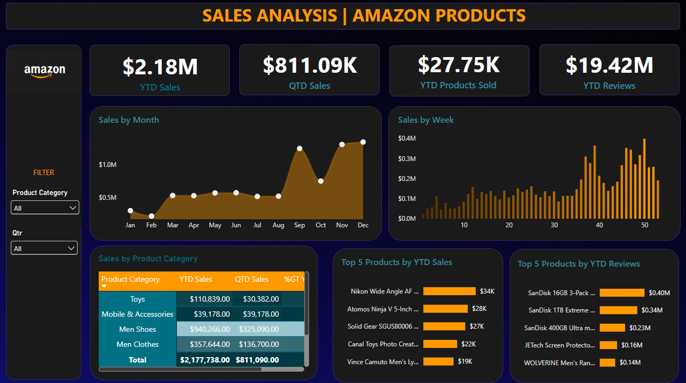

# Sales Analysis | Amazon Products: Sales Analytics Dashboard

🇪🇸 [Leer en español](README.md)

Personal portfolio project: a Power BI dashboard to monitor the sales performance of an online store, with year-to-date (YTD) and quarter-to-date (QTD) indicators.

> ⚠️ **Disclaimer:** The data used in this project is **fictitious** and **publicly available**, taken from a YouTube tutorial for educational purposes. It does not represent real sales of any company. This project has no relationship or affiliation with Amazon; its name and logo are used only as visual styling for the dashboard.

## Files

- 📊 [Download Power BI file (.pbix)](Sales_Analysis_Proyect_JoshuaChacon.pbix?raw=true)
- 📁 [Source data (Excel)](data/Amazon_Combined_Data.xlsx?raw=true)

## Context

A sales team needs a single view to track how the year is going: how much has been sold, how the current quarter is performing, which products and categories drive the business, and how customer reviews are behaving. The dashboard answers four key indicators and five visualizations defined in the project requirements.

## About the data

The dataset is a single Excel table (`Amazon_Data`) with the following characteristics:

| Feature | Detail |
| --- | --- |
| Records | 89,082 |
| Period | January 3, 2019 to December 31, 2022 |
| Product categories | 8 (Men Shoes, Men Clothes, Camera, Toys, Car Accessories, Mobile & Accessories, Audio Video, Laptop) |
| Distinct products (by description) | 67,942 |
| Columns | Product Category, Product Description, Price (Dollar), Number of reviews, Shipment, Order Date |
| Null values | None |

The dashboard shows the most recent year in the data, **2022**, so the year-to-date figure equals the full year.

## Key KPIs (2022)

| Indicator | Value |
| --- | --- |
| YTD Sales | $2,177,738 |
| QTD Sales (Q4) | $811,090 |
| YTD Products Sold | 27,747 |
| YTD Reviews | 19.42M |

## Visualizations

| Visual | Type | Purpose |
| --- | --- | --- |
| Sales by Month | Line / area | See monthly trends and seasonality |
| Sales by Week | Columns | Spot short-term fluctuations |
| Sales by Product Category | Table with heat map | Compare YTD, QTD and % of total by category |
| Top 5 Products by YTD Sales | Bars | Identify the products that generate the most revenue |
| Top 5 Products by YTD Reviews | Bars | Identify the products with the most reviews |

Available filters are **Product Category** and **Qtr**.

## Key findings

1. **2022 sales recover.** The $2.18M in 2022 is 33.5% above 2021 ($1.63M), though still below the 2020 peak ($3.10M). Units sold grow 17% compared to 2021.
2. **Three categories concentrate the business.** Men Shoes (43.2%), Camera (22.6%) and Men Clothes (16.4%) make up 82.2% of the year's sales.
3. **The second half carries a lot of weight.** September, November and December contribute 41.1% of annual sales, with November as the best month ($310K). February is the weakest month ($68K).
4. **The last quarter is the strongest.** Q4 represents 37.2% of the year's sales ($811K).
5. **High sales do not mean more reviews.** Mobile & Accessories accounts for only 1.8% of sales but holds 32.9% of reviews, more than any other category. All of its 2022 sales happen in Q4.
6. **Top products change depending on the criterion.** Among the five best sellers are a Nikon lens, an Atomos monitor and safety footwear. Among the five with the most reviews, three are SanDisk memory cards.

## Conclusion

The commercial performance of 2022 depends on a few categories (footwear, cameras and men's clothing) and on a strong season from September to December. Reviews follow a different pattern from sales, which suggests analyzing separately which products generate revenue and which generate customer engagement.

## Recommendations

- Strengthen inventory and campaigns in the second half of the year, especially in November and December.
- Protect and grow the three leading categories, and evaluate how to diversify the rest.
- Study why Mobile & Accessories generates so many reviews with so few sales, and whether there is an opportunity to turn that attention into purchases.
- Look into what happens in February to plan actions for the lowest month.

## Tools

Power BI Desktop · DAX · Excel

Author: [Joshua Chacón](https://github.com/joshuach17)
