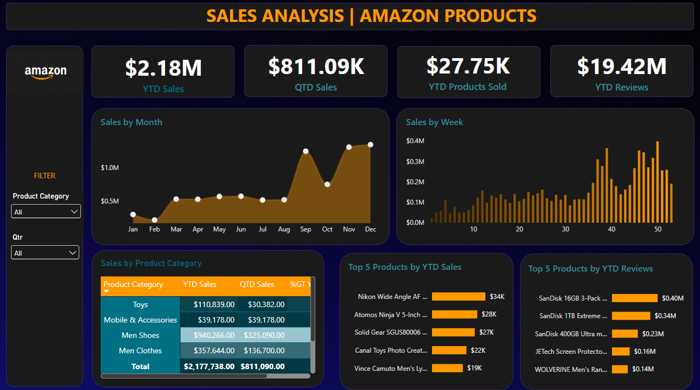

# Sales Analysis | Amazon Products: Dashboard de Análisis de Ventas

🇬🇧 [Read in English](README.en.md)

Proyecto de portafolio personal: dashboard en Power BI para monitorear el desempeño de ventas de una tienda en línea, con indicadores acumulados del año (YTD) y del trimestre (QTD).

> ⚠️ **Aviso:** los datos utilizados en este proyecto son **ficticios** y de **acceso público**, obtenidos de un tutorial de YouTube con fines educativos. No corresponden a ventas reales de ninguna empresa. Este proyecto no tiene relación ni afiliación con Amazon; su nombre y logo se usan solo como ambientación visual del dashboard.

## Archivos

- 📊 [Descargar archivo Power BI (.pbix)](Sales_Analysis_Proyect_JoshuaChacon.pbix)
- 📁 [Datos de origen (Excel)](data/Amazon_Combined_Data.xlsx)

## Contexto

Un equipo comercial necesita una vista única para seguir cómo van las ventas del año: cuánto se ha vendido, cómo va el trimestre actual, qué productos y categorías mueven el negocio y cómo se comportan las reseñas de los clientes. El dashboard responde a cuatro indicadores clave y cinco visualizaciones definidas en los requerimientos del proyecto.

## Sobre los datos

El dataset está en una sola tabla de Excel (`Amazon_Data`) con las siguientes características:

| Característica | Detalle |
| --- | --- |
| Registros | 89,082 |
| Periodo | 3 de enero de 2019 al 31 de diciembre de 2022 |
| Categorías de producto | 8 (Men Shoes, Men Clothes, Camera, Toys, Car Accessories, Mobile & Accessories, Audio Video, Laptop) |
| Productos distintos (por descripción) | 67,942 |
| Columnas | Product Category, Product Description, Price (Dollar), Number of reviews, Shipment, Order Date |
| Valores nulos | Ninguno |

El dashboard muestra el año más reciente de los datos, **2022**, por lo que el acumulado anual (YTD) equivale al año completo.

## KPIs principales (2022)

| Indicador | Valor |
| --- | --- |
| YTD Sales | $2,177,738 |
| QTD Sales (Q4) | $811,090 |
| YTD Products Sold | 27,747 |
| YTD Reviews | 19.42M |

## Visualizaciones

| Visual | Tipo | Objetivo |
| --- | --- | --- |
| Sales by Month | Línea / área | Ver tendencias y estacionalidad mensual |
| Sales by Week | Columnas | Detectar variaciones de corto plazo |
| Sales by Product Category | Tabla con mapa de calor | Comparar YTD, QTD y % del total por categoría |
| Top 5 Products by YTD Sales | Barras | Identificar los productos que más ingresos generan |
| Top 5 Products by YTD Reviews | Barras | Identificar los productos con más reseñas |

Los filtros disponibles son **Product Category** y **Qtr**.

## Hallazgos principales

1. **Las ventas de 2022 se recuperan.** Los $2.18M de 2022 superan en 33.5% a los de 2021 ($1.63M), aunque siguen por debajo del pico de 2020 ($3.10M). Las unidades vendidas crecen 17% frente a 2021.
2. **Tres categorías concentran el negocio.** Men Shoes (43.2%), Camera (22.6%) y Men Clothes (16.4%) suman el 82.2% de las ventas del año.
3. **El segundo semestre pesa mucho.** Septiembre, noviembre y diciembre aportan el 41.1% de las ventas anuales, con noviembre como el mejor mes ($310K). Febrero es el mes más débil ($68K).
4. **El último trimestre es el más fuerte.** El Q4 representa el 37.2% de las ventas del año ($811K).
5. **Vender mucho no significa tener más reseñas.** Mobile & Accessories aporta solo el 1.8% de las ventas, pero concentra el 32.9% de las reseñas, más que cualquier otra categoría. Todas sus ventas de 2022 ocurren en el Q4.
6. **Los productos líderes cambian según el criterio.** Entre los cinco con más ventas aparecen una lente Nikon, un monitor Atomos y calzado de seguridad. Entre los cinco con más reseñas, tres son tarjetas de memoria SanDisk.

## Conclusión

El desempeño comercial de 2022 depende de pocas categorías (calzado, cámaras y ropa de hombre) y de una fuerte temporada de septiembre a diciembre. Las reseñas siguen un patrón distinto al de las ventas, lo que sugiere analizar por separado qué productos generan ingresos y cuáles generan interacción con los clientes.

## Recomendaciones

- Reforzar inventario y campañas en el segundo semestre, sobre todo en noviembre y diciembre.
- Proteger y hacer crecer las tres categorías líderes, y evaluar cómo diversificar el resto.
- Estudiar por qué Mobile & Accessories genera tantas reseñas con tan pocas ventas, y si hay oportunidad de convertir esa atención en compras.
- Revisar qué ocurre en febrero para plantear acciones en el mes más bajo.

## Notas y limitaciones

- La columna `Number of reviews` parece ser el total de reseñas de cada publicación, no las reseñas recibidas en el periodo. Por eso el indicador YTD Reviews se debe leer como un valor de referencia y no como reseñas nuevas del año.
- El archivo original contiene 135 filas duplicadas exactas y 33 registros con precio de $0. No se eliminaron para conservar los datos tal como vienen en el tutorial.
- Cada registro se trata como una venta al precio listado; el dataset no incluye cantidades ni descuentos.

## Herramientas

Power BI Desktop · DAX · Excel

## Créditos

Requerimientos del proyecto y datos basados en un tutorial de YouTube del canal Data Tutorials: [ENLACE AL VIDEO].

Autor: [Joshua Chacón](https://github.com/joshuach17)
